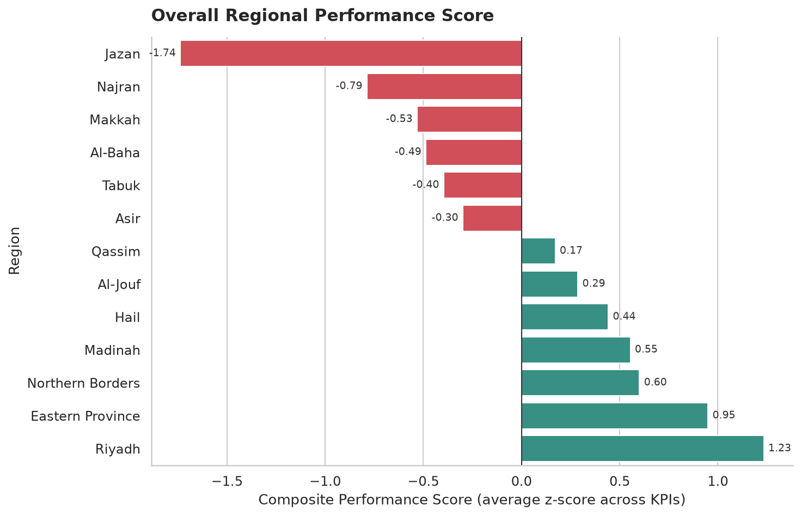

# Tayseer Government Services — Analytics & Visualization

Exploratory visual analysis of government-service KPIs across 13 regions, 4 service channels and 9 service categories (monthly data, mid-2021 to mid-2026), built with Python, Seaborn and Matplotlib.

> **Course project** — SDAIA *Data Visualization and Storytelling* (Aug 2026). The dataset was provided with the course materials and is likely synthetic, so the findings illustrate the analysis rather than real service performance.

## Questions answered
- How do transaction volumes and digital adoption evolve over time, by channel and by region?
- Which channels are fastest, and how do speed, cost, SLA compliance and satisfaction relate?
- Which regions lag once all KPIs are combined into one standardized score?

## Key findings
- **Channel shift:** Mobile App overtook Branch as the highest-volume channel around the start of 2024, and is also the fastest (median ≈ 7 min vs. ≈ 33 for Branch).
- **Channel drives service quality:** digital channels meet SLA about 97% of the time versus 88–90% for Branch and Call Center.
- **Cost, speed and satisfaction move together, partly through channel mix:** pooled correlations of about −0.7 to −0.8 between cost/completion time and CSAT/SLA, but only −0.37 to −0.47 between cost and CSAT within a single channel.
- **Regions:** Jazan is the weakest on the composite score (−1.74); Riyadh (+1.23) and Eastern Province (+0.95) lead. Makkah is the largest region by volume but scores below average.
- **Complaints:** by rate, Business & Licensing and Justice & Notary are highest (about 0.09 per 100 transactions), consistent with their lower satisfaction; raw counts mostly track volume.



## Repository structure
```
├── data/tayseer_services.csv
├── figures/                  # charts exported by the notebook
├── tayseer-services-analytics.ipynb
├── requirements.txt
└── README.md
```

## Run
```bash
pip install -r requirements.txt
jupyter notebook tayseer-services-analytics.ipynb   # Kernel > Restart & Run All
```

## Limitations
- The composite score uses z-scores across regions with equal KPI weights, so it is relative: about half of the regions fall below zero by construction.
- Pooled correlations can be driven by channel differences, and correlation does not imply causation.
